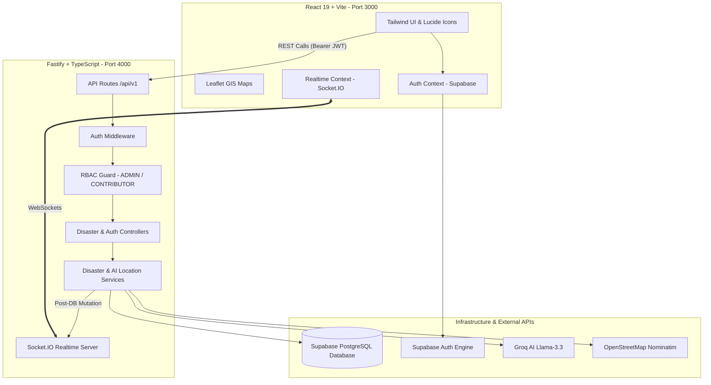

# 🚨 Disaster Response Coordination Platform

An end-to-end, full-stack disaster response and emergency relief coordination web application built with **React 19**, **Vite**, **TailwindCSS**, **Leaflet GIS Maps**, **Node.js**, **TypeScript**, **Fastify**, **Prisma ORM**, **Supabase PostgreSQL & Auth**, **Groq AI**, **OpenStreetMap Nominatim**, **Socket.IO WebSockets**, and **Haversine Proximity Search**.

---

## 📌 Project Overview

The **Disaster Response Coordination Platform** empowers emergency response teams, first responders, and coordinators to report disaster incidents, discover nearby emergency resources (shelters, hospitals, food, water, rescue operations) within a configurable geographic radius, track live emergency incidents via WebSockets, and aggregate community reports with high availability.

### Key Capabilities

- 🔐 **Secure Authentication & RBAC**: Real-time Supabase Auth with server-side Role-Based Access Control (`ADMIN` vs `CONTRIBUTOR`).
- 🗺️ **Geospatial Incident Mapping**: Interactive Leaflet GIS maps displaying active disaster zones, radius perimeters, and emergency resources.
- 🤖 **AI-Powered Location Extraction**: Automatic parsing of unstructured text descriptions into structured locations using Groq LLM (`llama-3.3-70b-versatile`).
- 📍 **Nominatim Geocoding**: Automatic translation of location strings into precise latitude/longitude coordinates with 24-hour in-memory geocode caching.
- 📐 **Haversine Resource Discovery**: Radius proximity search (e.g., 5km, 10km) sorting shelters, hospitals, food, water, and rescue units by distance.
- ⚡ **Realtime Event Streaming**: Live WebSocket notifications via Socket.IO whenever disaster incidents are created, updated, or resolved.
- 💬 **Community Reports Feed**: Social incident report aggregation with stale-fallback caching against external provider failures.
- 📱 **Responsive & Mobile-Optimized**: Mobile-first design with bottom navigation bars, fluid card grids, and interactive GIS modals.

---

## 🏗️ Repository Structure

```
Disaster/
├── backend/                  # Fastify + TypeScript API Server
│   ├── prisma/               # Database Schema, Migrations & Seeds
│   │   ├── schema.prisma     # Prisma ORM Models (Profile, Disaster, Resource)
│   │   └── seed.ts           # Initial Database Seeding Script
│   ├── src/
│   │   ├── config/           # Fail-fast Zod Environment Validation
│   │   ├── middleware/       # Auth & Authorization (RBAC) Middlewares
│   │   ├── modules/          # Disaster & Auth API Controllers, Services, Routes
│   │   ├── plugins/          # Prisma & Swagger Fastify Plugins
│   │   ├── realtime/         # Socket.IO WebSocket Event Emitter
│   │   ├── services/         # Groq AI, Nominatim, Haversine & Cache Services
│   │   └── server.ts         # Server Entry Point
│   └── tests/                # 100% Vitest Integration & Unit Test Suite
│
├── frontend/                 # React + Vite + TailwindCSS Frontend App
│   ├── src/
│   │   ├── api/              # API Client & Endpoint Wrappers
│   │   ├── components/       # UI Components, Cards, Modals, GIS Maps
│   │   ├── context/          # Auth & Realtime WebSocket Context Providers
│   │   ├── hooks/            # Custom React Hooks
│   │   ├── pages/            # Page Views (Dashboard, Disasters, Login, etc.)
│   │   └── routes/           # React Router Layout & Role Guards
│   └── vite.config.js        # Vite Bundler & Dev Server Config
│
├── .gitignore                # Root Git Ignore
└── README.md                 # Project Documentation
```

---

## ⚙️ Tech Stack & Architecture



---

## 🚀 Quick Start Guide

### Prerequisites

- **Node.js**: `v18.x` or higher (v20+ recommended)
- **npm**: `v9.x` or higher

### 1. Backend Setup

```bash
# Navigate to backend directory
cd backend

# Install dependencies
npm install

# Setup environment variables (.env file is pre-configured with Supabase & Groq keys)
cp .env.example .env

# Generate Prisma Client & Push Database Schema
npx prisma db push

# Seed the database with sample disasters and emergency resources
npm run db:seed

# Start the dev backend server (Port 4000)
npm run dev
```

The backend server will run at:
- **API Base**: `http://localhost:4000/api/v1`
- **Swagger Documentation**: `http://localhost:4000/api/docs`
- **Health Check**: `http://localhost:4000/health`

### 2. Frontend Setup

```bash
# Open a new terminal and navigate to frontend directory
cd frontend

# Install dependencies
npm install

# Start the dev frontend application (Port 3000)
npm run dev
```

Open `http://localhost:3000` in your web browser.

---

## 🔐 User Roles & Authentication

The platform supports **Role-Based Access Control (RBAC)**:

| Role | Permissions |
|---|---|
| 👑 **ADMIN** | Full access: View, create, update, and **delete** disaster incidents. |
| 👷 **CONTRIBUTOR** | Standard access: View, create, and update disaster incidents. (Delete forbidden with `403 Forbidden`). |

---

## 🧪 Running Tests

### Backend Test Suite
Run the 100% automated test suite (19 integration & unit tests):

```bash
cd backend
npm run test
```

---

## 📄 License

Distributed under the ISC License. See `LICENSE` for more information.
